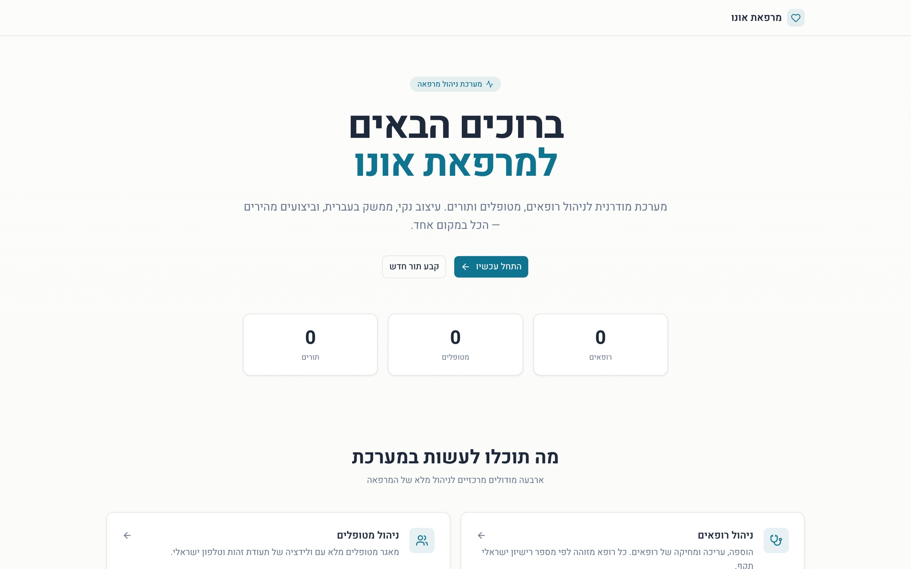
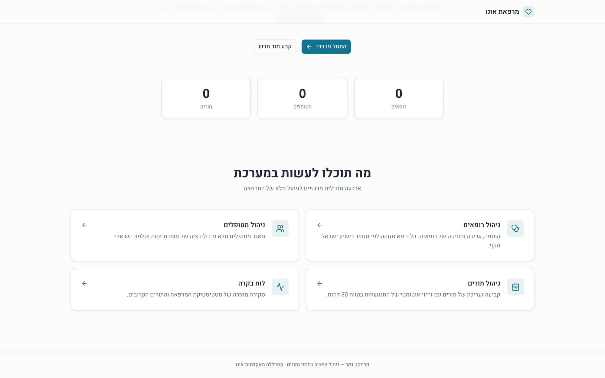

<p align="center">
  
</p>

<h1 align="center">מערכת ניהול מרפאה · Ono Clinic</h1>

<p align="center">
  <b>A Hebrew, right-to-left clinic management system — doctors, patients and appointments, with the business rules enforced in the database rather than hoped for in the UI.</b><br>
  <sub>Final project, <i>Database Design &amp; Management</i> — Ono Academic College</sub>
</p>

<p align="center">
  <a href="https://ono-clinic-mvp.vercel.app"></a>
  
  
  
  
</p>

<p align="center"><a href="#hebrew"><b>עברית ↓</b></a></p>

---

## What it does

Four modules, in Hebrew, right to left:

| Module | Operations |
|---|---|
| **Doctors** | Create, edit, delete — **deletion blocked while appointments exist** |
| **Patients** | Create, edit, delete — same rule |
| **Appointments** | Book, edit, delete, with a **30-minute conflict check** |
| **Dashboard** | Counts and the five next appointments |

<p align="center">
  
</p>

## The part that matters: the rules live in the schema

This is a database course project, so the point is not the screens — it is **where a rule is
enforced**.

- **`ON DELETE RESTRICT` on both of `Appointment`'s foreign keys.** You cannot delete a doctor or a
  patient who still has appointments. Not because a button is hidden, but because the database
  refuses. A UI guard can be bypassed by anything that is not the UI.
- **A composite index on `(doctor_license, appointment_date)`** — the conflict check queries exactly
  that pair, so it reads an index instead of scanning the table.
- **Natural primary keys.** A doctor is keyed by his 5-digit Israeli medical licence, a patient by
  her 9-digit *teudat zehut*. These identifiers already exist, are already unique and are already
  what the staff types — a surrogate `id` would only add a column to join on.
- **Israeli check-digit validation** on the identity number, in the application layer, with unit
  tests. The database guarantees uniqueness; the application guarantees the number is real.

```
Doctor   license_number (PK, 5 digits) · name
Patient  id_number (PK, 9 digits + check digit) · name · phone
Appointment  FK → Doctor · FK → Patient · appointment_date (timestamptz) · reason
             ON DELETE RESTRICT on both FKs
             index (doctor_license, appointment_date)
```

Dates are stored as `timestamptz`. A clinic that books in local time and stores naive timestamps
discovers the problem twice a year.

## Architecture

```
Next.js 16 (App Router)
├── Server Components       rendered on the server, no JavaScript shipped for them
├── Server Actions          mutations go straight to the database — no REST layer to secure
├── React Hook Form + Zod 4 the same schema validates on the client and on the server
└── Prisma 6 + Neon         ORM over serverless Postgres
```

```
src/
├── app/
│   ├── (clinic)/          route group — shell + sidebar
│   │   ├── dashboard/
│   │   ├── doctors/       list · new · [license]/edit
│   │   ├── patients/      list · new · [id]/edit
│   │   └── appointments/  list · new · [id]/edit
│   └── layout.tsx         RTL + Heebo + ThemeProvider
├── components/layout/     ClinicShell · AppHeader · AppSidebar · ThemeToggle
└── lib/
    ├── schemas/           Zod schemas — doctor, patient, appointment (with tests)
    ├── action-helpers.ts  validate() utility
    └── db.ts              the Prisma client
```

**One schema, two sides.** The Zod schema that validates the form in the browser is the same one the
Server Action runs before touching the database. A rule cannot drift between the two because there
is only one of it.

## Stack

| Tool | Version | Role |
|---|---|---|
| Next.js | 16 | App Router, Server Actions |
| React | 19 | UI |
| TypeScript | 5 | strict mode |
| Tailwind CSS | 4 | styling |
| Prisma | 6 | ORM |
| Neon | — | serverless Postgres |
| Zod | 4 | validation, client and server |
| React Hook Form | 7 | form state |
| shadcn/ui (Base UI) | — | components |
| Sonner · next-themes · Heebo | — | toasts · dark mode · Hebrew font |

## Run it locally

```bash
pnpm install

# .env.local
DATABASE_URL="postgresql://..."   # Neon, connection pooling
DIRECT_URL="postgresql://..."     # Neon, direct — used for migrations

pnpm prisma generate
pnpm prisma db push
pnpm prisma db seed
pnpm dev                          # http://localhost:3000
```

```bash
pnpm test            # Vitest
pnpm lint            # ESLint
pnpm prisma studio   # browse the database
```

---

<a id="hebrew"></a>
<div dir="rtl">

## בעברית

**מערכת ניהול מרפאה** בעברית מלאה, RTL ורספונסיבית: ניהול רופאים, מטופלים ותורים.
פרויקט גמר בקורס **ניהול ועיצוב בסיסי נתונים**, המכללה האקדמית אונו.

**מודולים**

| מודול | פעולות |
|---|---|
| **רופאים** | הוספה, עריכה, מחיקה — **חסומה אם יש תורים** |
| **מטופלים** | הוספה, עריכה, מחיקה — אותו כלל |
| **תורים** | קביעה, עריכה, מחיקה עם **זיהוי התנגשות של 30 דקות** |
| **לוח בקרה** | ספירות ו־5 התורים הקרובים |

**מה שחשוב באמת — הכללים יושבים בסכימה**

- `ON DELETE RESTRICT` על שני ה־FK של `Appointment`: אי אפשר למחוק רופא או מטופל שיש לו תורים.
  לא כי הכפתור מוסתר, אלא כי מסד הנתונים מסרב.
- אינדקס מורכב `(doctor_license, appointment_date)` — בדיקת ההתנגשות קוראת בדיוק את הצמד הזה.
- **מפתחות טבעיים**: רישיון רופא ישראלי (5 ספרות) ותעודת זהות (9 ספרות). מזהים שכבר קיימים, כבר
  ייחודיים וכבר מה שהצוות מקליד.
- ולידציית **ספרת ביקורת** של תעודת הזהות בשכבת האפליקציה, עם בדיקות יחידה.

**ארכיטקטורה:** Next.js 16 · Server Components · Server Actions (ללא שכבת REST) ·
React Hook Form + Zod 4 — **אותה סכימה מאמתת בדפדפן ובשרת** · Prisma 6 + Neon Postgres.

**התקנה:** ראו הפקודות בחלק האנגלי למעלה.

</div>

---

<p align="center"><sub>פרויקט גמר — המכללה האקדמית אונו, 2025</sub></p>
